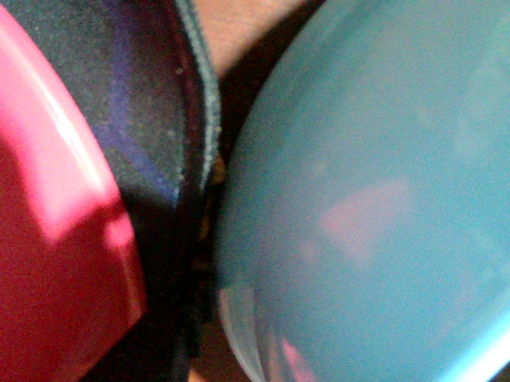
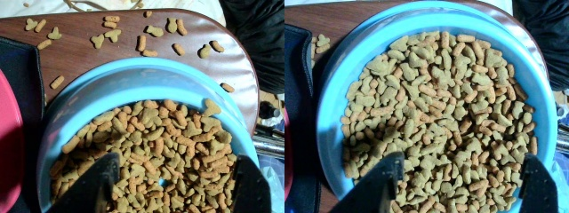
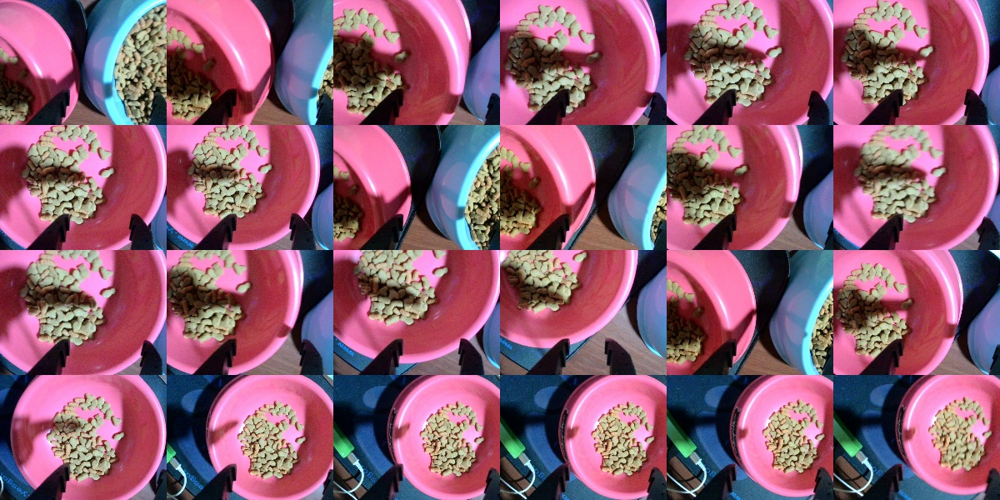
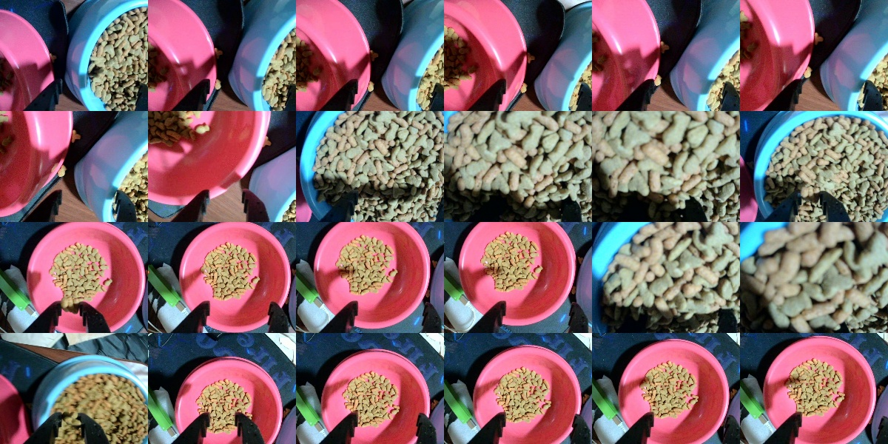

# 提出後の改善記録：ACT 4000 steps の実機評価

提出（2026-11-01）後に行った追加学習と実機評価の記録です。提出物（動画・説明資料PDF）には含まれていません。

## 概要

| 項目 | 内容 |
|---|---|
| モデル | ACT（テレオペ30エピソード）、CPU学習 1000 → 4000 steps |
| 実行 | `lerobot-rollout`（episodic、各25秒 × 3エピソード、CPU推論 約22Hz） |
| ベスト結果 | 3本中2本で「青皿に入る → グリッパーを閉じる → 赤皿の上へ移動」を通しで実行 |
| 未確認 | フードを実際に運べたか（グリッパーがほぼ全閉=空振りの可能性あり） |

## 評価の経過

| 回 | 日時 (JST) | 条件 | 結果 |
|---|---|---|---|
| 1 | 11/01 21:38 | 開始姿勢＝起動時の姿勢（赤皿の上） | 赤皿の上で停滞。評価不可 |
| 2 | 11/01 22:10 | 開始姿勢を青皿側に指定 | 1/3 本が把持して赤皿方向へ。残りは皿の横で停滞 |
| 3 | 11/01 22:14 | 脱力の問題を修正 | 開始姿勢は正しくなったが、赤皿へ直行して停滞 |
| 4 | 11/02 15:56 | 同上 | **2/3 本が 青皿 → 把持 → 赤皿 を通しで実行** |

## 見つけた問題と対処

1. **開始姿勢が赤皿の上になっていた**
   `lerobot-rollout` は、起動した時点の関節角を「初期姿勢」として記録し、エピソードごとにそこへ戻る。
   → [`scripts/win_goto_start.py`](../scripts/win_goto_start.py) を追加。学習データの開始姿勢の中央値（青皿の上）までゆっくり移動してから rollout を起動する。

2. **開始姿勢に移動した後、アームが脱力して下がった**
   `disconnect()` の既定動作ではトルクがOFFになり、rollout が起動するまでに重力で肩が 29° → 56° まで落ちていた。
   → `SO101FollowerConfig(disable_torque_on_disconnect=False)` でトルクを保持する。

3. **手首カメラの番号が変わった**
   常駐アプリを止めるとカメラの並び順が変わり、index 2 → 1 になった。
   → `win_eval_catfood.ps1` の既定値を 1 に変更。

4. **推論が極端に遅かった**
   空きメモリが 0.35GB しかなかった。常駐アプリを止めて 1.8GB 確保したところ、約22Hz で安定した。

## 手首カメラの記録

開始姿勢（左：今回の開始姿勢／右：学習データの開始時）

 

3回目（3エピソードを時系列に24コマ）：赤皿へ直行して停滞

4回目：2・3本目が青皿の中に入り、把持して赤皿へ移動

## デジタルツイン

[`scripts/win_twin_replay.py`](../scripts/win_twin_replay.py) は、録画データの関節角を MuJoCo の SO-101 モデルで再生し、実機の手首カメラ映像と並べた動画を作るスクリプトです。モデルファイル（`sim/so101/`）は [TheRobotStudio/SO-ARM100](https://github.com/TheRobotStudio/SO-ARM100)（Apache-2.0）から取得してください。STLファイルが約16MBあるため、このリポジトリには含めていません。

## 次の改善候補

- 評価のたびに赤皿を空にして、学習時と同じ初期状態をそろえる（3回目は赤皿にフードが残っており、「移し終わった場面」と誤認した可能性がある）
- 俯瞰カメラ（Ring）の映像で、実際に運べた量を数える
- 学習時の開始構図（青皿を真上から見下ろす）に合わせて、皿の位置をマーキングする
